# 研岸｜台灣研究所考古題，逐題練習、逐題詳解

**網站：[grad.examshore.com](https://grad.examshore.com/)**
完整介紹頁：[b01b02014.github.io/grad-exam](https://b01b02014.github.io/grad-exam/)

研岸是台灣研究所考古題的練習網站。收錄 26 所國立大學、108 到 115 學年共 **13,106 份**考卷，
每份都拆成一題一題（超過 16 萬題），可以逐題作答、把思路存下來，再對照這一題的完整詳解。
電資、理工、法商、文、社科傳播、生命科學、醫學到其他學群，一個帳號八大學群全部通用。

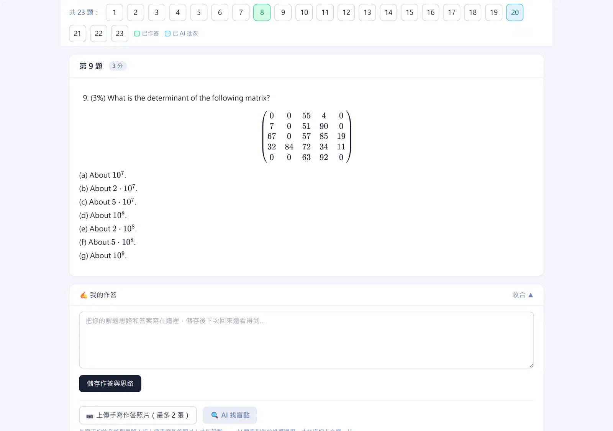

## 網站特色

### 三下就找到你要考的那份卷

從學群一路點到學校，考科和年度一鍵篩選，整個校系的考卷一次列出來。寫過的考卷在列表上會有藍點。

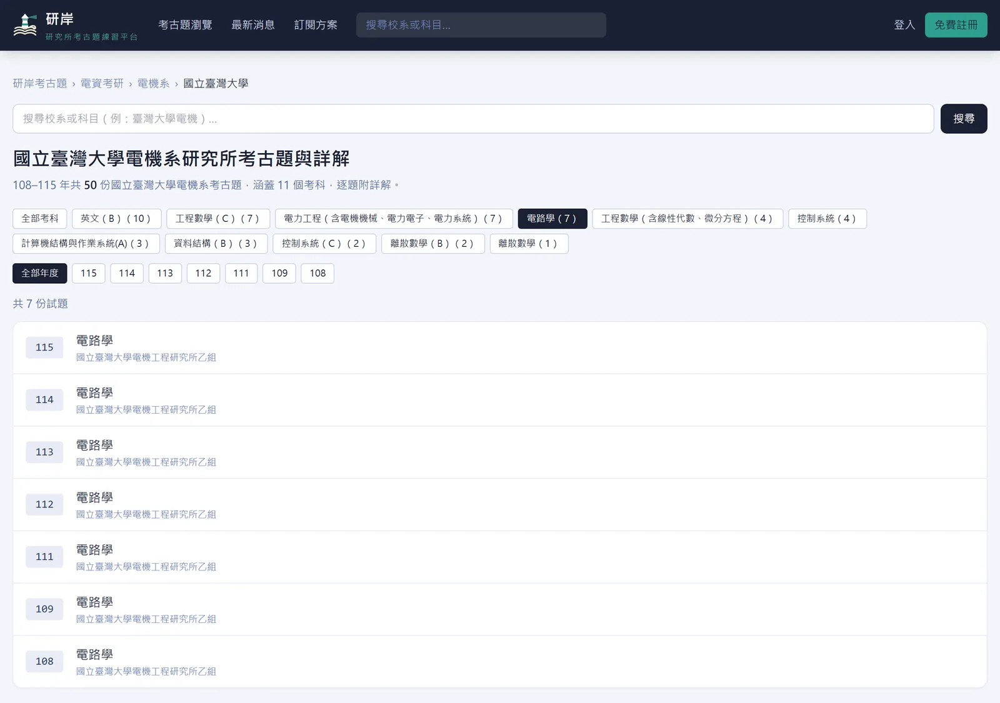

搜尋框打縮寫也找得到：台大／臺大通用，認得成大、政大、台聯大等校名縮寫與資工、化工、企管等系所簡稱，
多個關鍵字不用空格，還能加上年度，例如「台大通訊」「113 成大化工」「113 台大 統計學」。

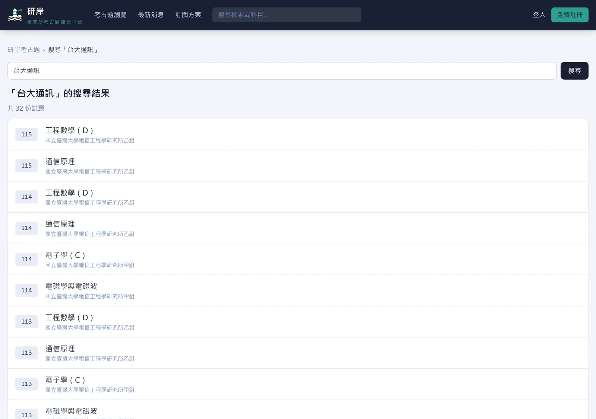

**冷門考科也找得到**：研岸收錄上千個考科，牙周病學、獸醫流行病學、水產養殖學、海洋物理學、地形學與地景保育這類補習班不開課的科目，
搜尋框打科目名稱就有，每題一樣附詳解。

### 先寫，再看詳解

- 整份考卷在同一頁，上方的題號列可以一鍵跳題，每題標示配分。
- 在「我的作答」寫下思路，按「儲存作答與思路」，換裝置、隔天回來都還在。題號列上綠色的是寫過的題目。
- 詳解預設收起來，按「顯示詳解」才打開，不會不小心先看到答案。
- 網址後面加上 `?q=題號` 會直接跳到那一題。

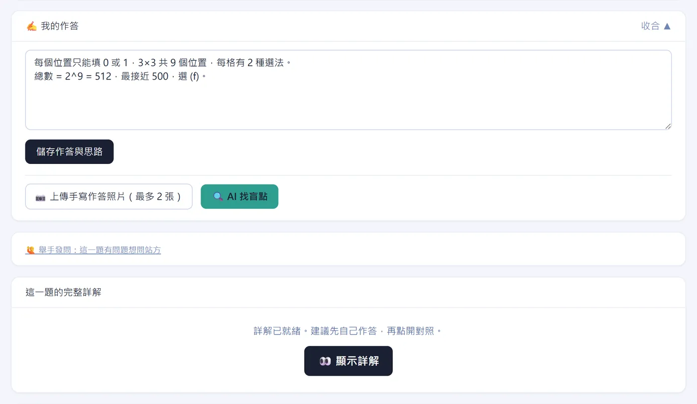

### 每一題都有完整詳解

詳解照「核心觀念、解題方法、選項分析、解題技巧、答案」的順序寫，選擇題會把每個選項為什麼對、為什麼錯都講清楚。
矩陣、積分、化學式都完整排版。發現有誤可以在詳解下方回報，站方的回覆會出現在「我的帳戶」。

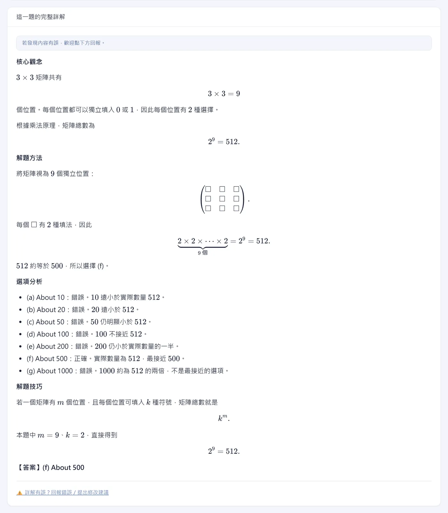

### 盲點診斷：找出你卡在哪一步

詳解告訴你這題怎麼解，盲點診斷告訴你「你」為什麼解不出來。在「我的作答」寫下過程，
或按「上傳手寫作答照片」（最多 2 張），再按「AI 找盲點」，系統會對照標準解法，指出卡住的步驟、缺的觀念，
還有下次怎麼自己檢查。照片只用於這一次診斷，不會保存在伺服器。

下圖是一份示範作答：把 E[3^Y] 直接寫成 3^E[Y]，診斷指出錯在「把期望值搬進非線性函數」。

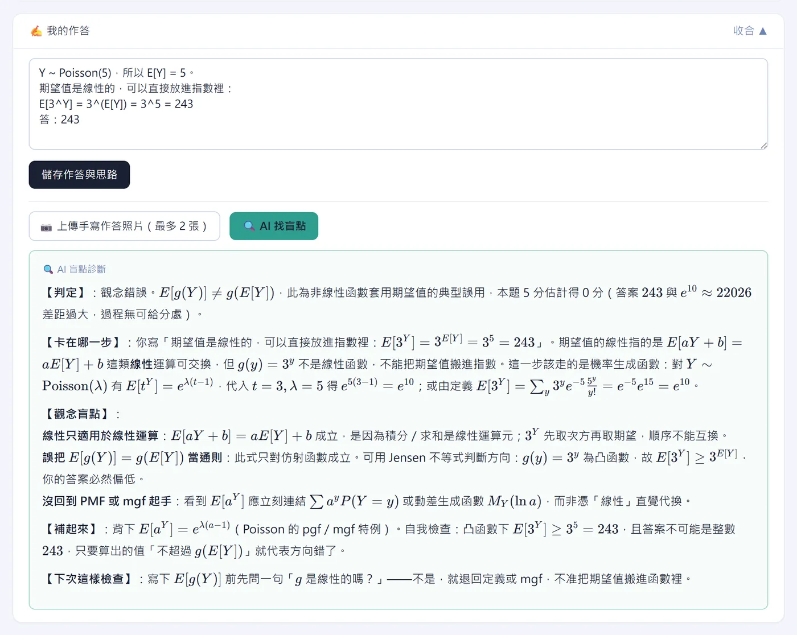

### 本題相關概念總複習

把這一題背後的整塊觀念整理成考前複習：這題在考什麼、必懂的觀念、常考的變形、容易混淆的地方。

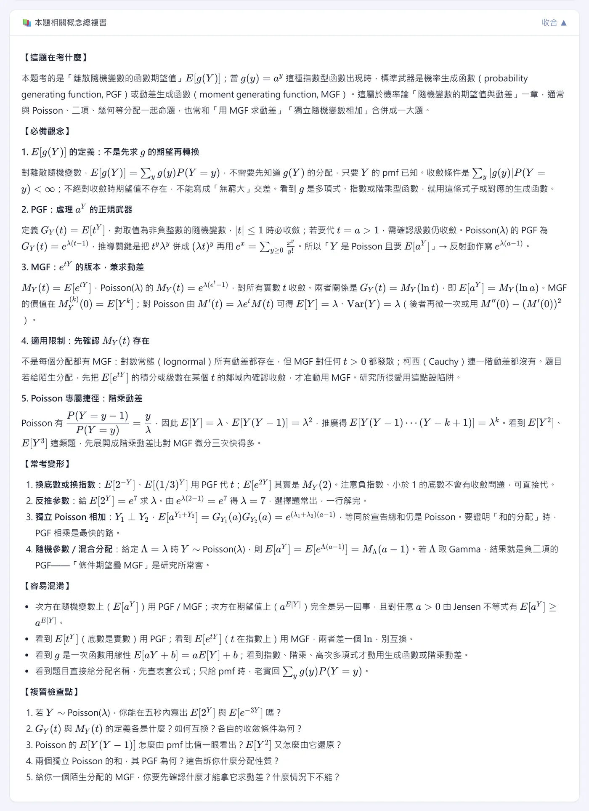

### 討論區與舉手發問

每一題下方都有討論區，可以分享解法、討論詳解。想直接問站方就用「舉手發問」，回覆會出現在「我的帳戶」。

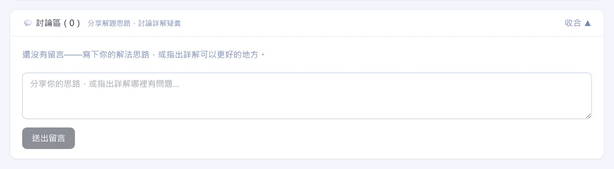

### 題組與附圖，照原卷排好

多題共用一段文章或數據的題組，共用題幹會集中放在第一題前面；有圖表的題目會附上原卷對應頁面，
登入後也能展開整份原卷 PDF 對照。

| 共用題幹＋原卷頁面 | 閱讀題組 |
|---|---|
| 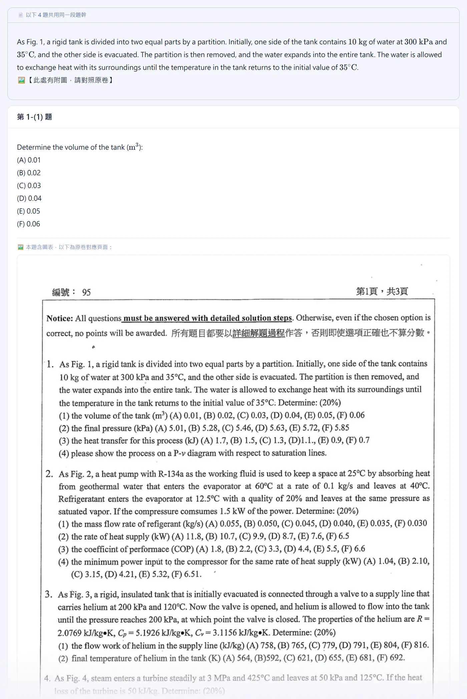 | 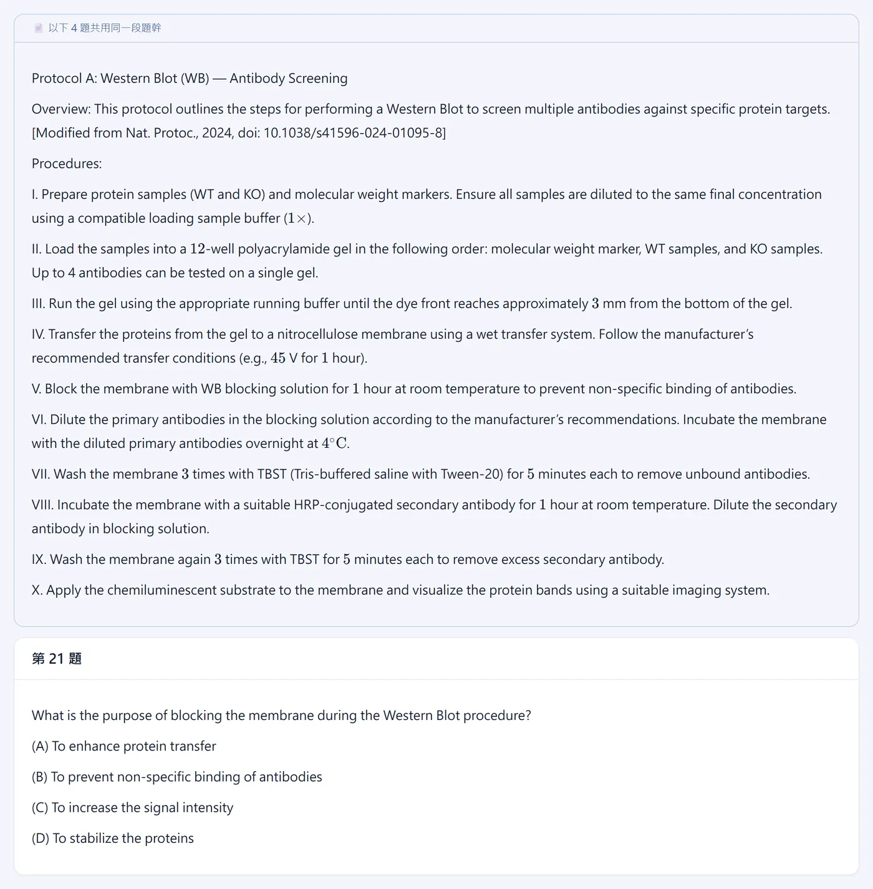 |

### 四種顯示模式

頁面最下方的「顯示模式」可以切換 **標準／深色／護眼／高對比**，不用登入，選一次就會記住。
深色適合晚上，護眼用米黃底，高對比加深文字與框線，視力不好或在戶外強光下也看得清楚。

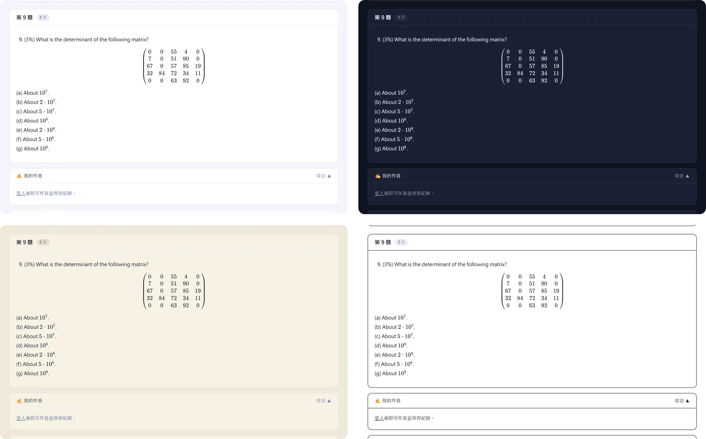

### 手機、平板都順手，零碎時間也能刷一題

手機上題號列收成一行可以左右滑，▲▼ 切換上下題，按「全部」展開完整題號；長算式可以左右滑、上傳照片直接開相機。通勤、排隊、午休的空檔，打開就能接著練。

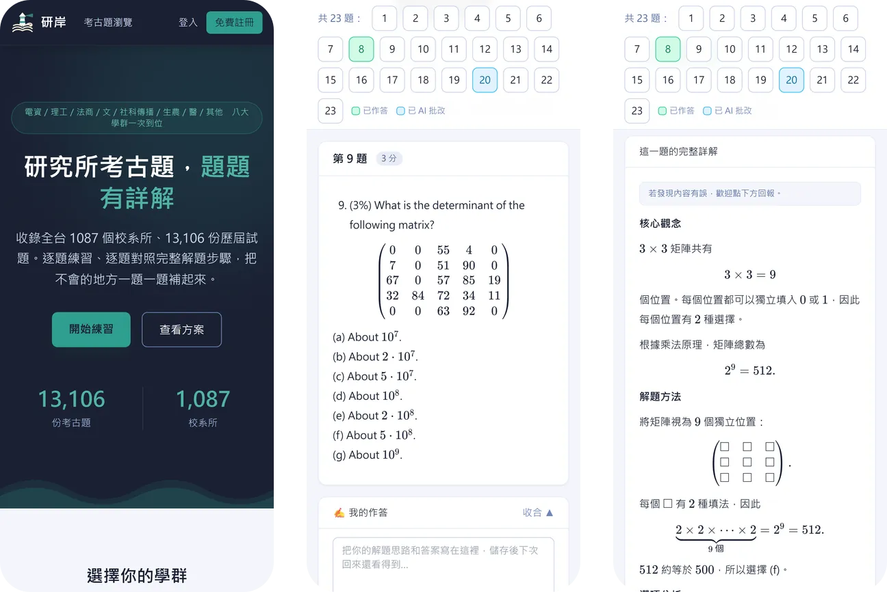

- **一次一題**：題號列直接跳到還沒寫的題目，五分鐘也有進度。
- **先寫再看**：手機寫下思路，晚上用電腦再對照詳解，作答紀錄跟著帳號走。
- **把題目傳給自己**：複製帶 `?q=題號` 的網址，換裝置直接打開同一題。
- **安裝到主畫面**：iPhone／iPad 用 Safari「分享」→「加入主畫面」；Android 或電腦用瀏覽器選單「安裝應用程式」，之後像 App 一樣直接開啟。

## 使用方法

1. **找考卷**：首頁選學群，或在搜尋框打「台大電機」「113 成大化工」。
2. **逐題作答**：在每題下方的「我的作答」寫下思路，按「儲存作答與思路」。
3. **對照詳解**：按「顯示詳解」，看核心觀念、推導與答案。
4. **找出盲點**：卡住就按「AI 找盲點」，或展開「本題相關概念總複習」。
5. **討論或發問**：在討論區分享解法，或用「舉手發問」直接問站方。

登入只要 Google 或 LINE 一鍵完成，不用另外設定密碼。

## 收錄範圍

| 學群 | 份數 | 涵蓋 |
|---|---:|---|
| [電資學群考古題](https://grad.examshore.com/exams/eecs) | 1,096 | 電機、資工、電子、通訊、光電 |
| [理工學群考古題](https://grad.examshore.com/exams/engineering) | 3,043 | 機械、化工、土木、材料、物理、化學、數學 |
| [法商學群考古題](https://grad.examshore.com/exams/law-business) | 3,041 | 法律、企管、財金會計、經濟、統計、資管 |
| [文學群考古題](https://grad.examshore.com/exams/humanities) | 1,061 | 中文、外文、歷史、哲學、教育 |
| [社會科學與傳播考古題](https://grad.examshore.com/exams/social-science) | 719 | 社會、心理、政治、傳播 |
| [生命科學與農學考古題](https://grad.examshore.com/exams/life-science) | 1,515 | 生科、生化、食品科學、農藝 |
| [醫學類考古題](https://grad.examshore.com/exams/medicine) | 1,016 | 醫學、藥學、護理、公衛、獸醫 |
| [其他學群考古題](https://grad.examshore.com/exams/others) | 1,615 | 體育、藝術、警政、軍事與其他 |

## 熱門校系考古題

- **電資**：[台大電機所](https://grad.examshore.com/exams/eecs/ee/ntu)、[台大資工所](https://grad.examshore.com/exams/eecs/cs/ntu)、[台大電子所](https://grad.examshore.com/exams/eecs/electronics/ntu)、[台大電信所](https://grad.examshore.com/exams/eecs/communication/ntu)、[台聯大電機類](https://grad.examshore.com/exams/eecs/ee/ust)、[成大電機所](https://grad.examshore.com/exams/eecs/ee/ncku)、[中山電機所](https://grad.examshore.com/exams/eecs/ee/nsysu)、[中正電機所](https://grad.examshore.com/exams/eecs/ee/ccu)
- **理工**：[台大土木與營建](https://grad.examshore.com/exams/engineering/civil-construction/ntu)、[成大機械與機電](https://grad.examshore.com/exams/engineering/mechanical/ncku)、[台大化工與材料](https://grad.examshore.com/exams/engineering/chemical-materials/ntu)、[台大化學所](https://grad.examshore.com/exams/engineering/chemistry/ntu)、[台大物理與地科](https://grad.examshore.com/exams/engineering/physics-earth-science/ntu)
- **法商**：[台大法律所](https://grad.examshore.com/exams/law-business/law/ntu)、[政大法律所](https://grad.examshore.com/exams/law-business/law/nccu)、[政大企管與商學](https://grad.examshore.com/exams/law-business/business-management/nccu)、[台大財金會計](https://grad.examshore.com/exams/law-business/finance-accounting/ntu)
- **文**：[台大外文與語言](https://grad.examshore.com/exams/humanities/foreign-languages/ntu)、[政大外文與語言](https://grad.examshore.com/exams/humanities/foreign-languages/nccu)、[台大中文所](https://grad.examshore.com/exams/humanities/chinese-literature/ntu)、[清大歷史所](https://grad.examshore.com/exams/humanities/history/nthu)
- **社會科學與傳播**：[台大心理諮商](https://grad.examshore.com/exams/social-science/psychology-counseling/ntu)、[政大社會與社工](https://grad.examshore.com/exams/social-science/sociology-social-work/nccu)、[政大傳播與新聞](https://grad.examshore.com/exams/social-science/communication-journalism/nccu)
- **生命科學與農學**：[台大生物生化](https://grad.examshore.com/exams/life-science/biology-biochemistry/ntu)、[台大農學相關](https://grad.examshore.com/exams/life-science/agriculture/ntu)、[清大生科所](https://grad.examshore.com/exams/life-science/life-sciences/nthu)
- **醫學類**：[台大醫學與臨床](https://grad.examshore.com/exams/medicine/medicine-clinical/ntu)、[成大醫學與臨床](https://grad.examshore.com/exams/medicine/medicine-clinical/ncku)、[台大護理所](https://grad.examshore.com/exams/medicine/nursing/ntu)、[台大藥學所](https://grad.examshore.com/exams/medicine/pharmacy/ntu)

更多校系請看[完整介紹頁](https://b01b02014.github.io/grad-exam/#schools)或直接到[研岸考古題總覽](https://grad.examshore.com/exams)。

## 註冊與方案

新會員註冊後 3 天內可以看全站完整詳解；每份考卷的第 1 題，註冊會員隨時都能看完整詳解，
也能逐題作答、保存紀錄、對照原卷 PDF。方案說明見[方案頁](https://grad.examshore.com/pricing)。

## 聯絡

- 網站：[grad.examshore.com](https://grad.examshore.com/)
- 最新消息：[grad.examshore.com/news](https://grad.examshore.com/news)
- Email：service@examshore.com

考古題著作權屬各校所有，研岸僅供考生學習使用。
